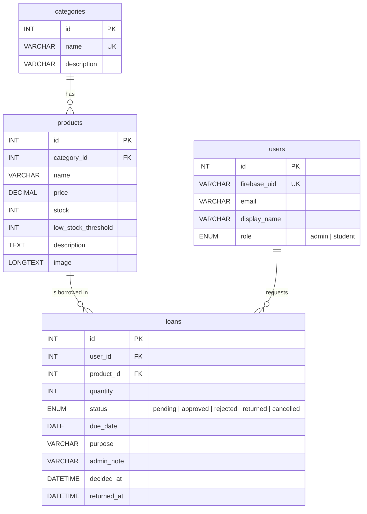

# Focus Frame Studio — Equipment Inventory & Borrowing System

A full-stack web app for a photography studio's equipment room. Admins manage the
inventory and approve borrow requests; students browse the catalog, request gear
and track their loans.

| Layer | Technology |
|---|---|
| Frontend | React 19 (functional components + Hooks), React-Bootstrap / Bootstrap 5.3, React Router, Vite |
| Backend | Node.js + Express 5 REST API (`cors`, `express.json()`, central error handler) |
| Database | MySQL (developed on XAMPP / MariaDB, deployed to a cloud MySQL host) with `mysql2` |
| Auth | Firebase Authentication (Google Sign-In); the API verifies the ID token with `firebase-admin` |
| Hosting | Netlify (frontend) · Render (API) · Aiven / TiDB Cloud / Railway / Clever Cloud (MySQL) |

---

## Features

**Admin**
- **Overview** — live stat cards, pending requests with one-click approve/reject, low-stock watch, overdue returns.
- **Inventory** — full CRUD for equipment with validated forms, photo upload (auto-resized), search, category/stock filters, sorting, quick restock / write-off (`PATCH`), CSV export.
- **Categories** — CRUD; a category in use cannot be deleted.
- **Loans** — filter by status (pending, on loan, overdue, returned…), approve / reject / mark returned with an optional note.
- **Reports** — stock health, stock and value by category, most borrowed equipment, most active borrowers (all computed in SQL).

**Student**
- **Catalog** — search, category chips, availability filter, sorting, request-to-borrow form (quantity ≤ stock, return date within 30 days).
- **My loans** — request status, due dates, overdue warnings, admin notes, cancel a pending request.

**Business rules (enforced by the API)**
- Approving a loan subtracts its quantity from stock; returning adds it back. Both run in a **transaction with `SELECT … FOR UPDATE` row locks**, so stock can never go negative even if two admins approve at once.
- Loan lifecycle: `pending → approved → returned`, or `pending → rejected / cancelled`. Any other change returns `409 Conflict`.
- Only one pending request per student per item. Students can only see and cancel their own loans.
- Products with loan history cannot be deleted (history is kept) — set stock to 0 instead.

---

## Database design

Four normalized tables (3NF) with primary keys, foreign keys, unique keys, CHECK constraints and indexes.
Full DDL: [`backend/database/schema.sql`](backend/database/schema.sql).



- Category names live once in `categories` (previously repeated as text on every product).
- Users sign in with Firebase, and the API copies each account into `users` on first request so `loans` can reference it with a real foreign key. Roles are stored here (`ADMIN_EMAILS` decides who is admin).
- Seed data ([`backend/database/seed.sql`](backend/database/seed.sql)): 7 categories, 77 products, 3 demo students and 8 demo loans (dates are relative to the import day, so there is always an overdue example).

---

## REST API

Base URL: `http://localhost:5000/api` locally, `https://<your-service>.onrender.com/api` in production.
Protected routes need `Authorization: Bearer <Firebase ID token>`.

| Method | Path | Access | Purpose | Success |
|---|---|---|---|---|
| GET | `/health` | public | API + database health check | 200 / 503 |
| GET | `/me` | signed in | Current user's profile and role | 200 |
| GET | `/products?search=&categoryId=&stock=low\|out\|available&sort=` | public | List products (JOIN categories + loan totals) | 200 |
| GET | `/products/:id` | public | One product | 200 |
| POST | `/products` | admin | Create | 201 |
| PUT | `/products/:id` | admin | Update all fields | 200 |
| PATCH | `/products/:id/stock` | admin | `{ adjustment: +n / -n }` restock or write-off | 200 |
| DELETE | `/products/:id` | admin | Delete (409 if it has loans) | 204 |
| GET | `/categories` | public | List with product counts, units, value | 200 |
| POST / PUT / DELETE | `/categories[/:id]` | admin | Category CRUD (409 on duplicate name / in use) | 201 / 200 / 204 |
| GET | `/loans?status=` | signed in | Admin: all loans. Student: own loans | 200 |
| POST | `/loans` | signed in | Request to borrow | 201 |
| PATCH | `/loans/:id/status` | admin / owner | Approve, reject, return, cancel | 200 |
| GET | `/stats/summary` | admin | Dashboard and report aggregates | 200 |

**Errors** all use one JSON shape from the central error handler
(`backend/src/middleware/errors.js`):

```json
{ "error": { "status": 400, "message": "Please fix the highlighted fields.", "fields": { "price": "Price must be at least 0." } } }
```

| Status | When |
|---|---|
| 400 | Validation failed, malformed JSON, bad ID, unknown category |
| 401 | Missing / invalid / expired Firebase token |
| 403 | Signed in but not allowed (e.g. student calling an admin route) |
| 404 | Record or route not found |
| 409 | Duplicate name, record in use, invalid loan transition, not enough stock |
| 413 | Request body too large |
| 503 | Database unreachable |

---

## Project structure

```
backend/
  server.js                 starts the API (runs migrations first)
  src/app.js                Express app: middleware, routes, error handling
  src/config.js             every environment variable in one place
  src/db/pool.js            mysql2 connection pool (TLS for cloud hosts)
  src/db/migrate.js         creates/upgrades tables, seeds an empty database
  src/middleware/           auth.js (token + role), errors.js, requestLogger.js
  src/routes/               products, categories, loans, stats, system (health, me)
  src/utils/                ApiError, request validator
  database/schema.sql       DDL       database/seed.sql   seed data
  scripts/setup-db.js       npm run db:setup  (migrate any MySQL host)
  tests/api.test.js         end-to-end API tests
frontend/
  src/App.jsx               routes + role guards
  src/api/client.js         fetch wrapper (base URL, token, errors)
  src/context/              AuthContext, AdminDataContext, ToastContext
  src/components/           AppShell (navbar), forms/modals, LoanList, ui.jsx
  src/pages/admin/          Overview, Inventory, Categories, Loans, Reports
  src/pages/student/        Catalog, My loans
  src/styles/theme.css      Bootstrap theme overrides
  public/_redirects         SPA fallback for Netlify
database/focus_frame_db.sql one-file import for phpMyAdmin (creates focus_frame_db)
```

---

## Run locally (XAMPP)

1. **Start MySQL** in the XAMPP Control Panel.
2. **Create the database** — either
   - phpMyAdmin → **Import** → `database/focus_frame_db.sql` (creates `focus_frame_db`, tables and seed data), or
   - create an empty `focus_frame_db` and let the API build it on first start.

   > Upgrading from the earlier single-table version? Just start the new API (or run `npm run db:setup`). It detects the old `products.category` text column, moves the values into the new `categories` table and adds the foreign key, keeping your existing products.
3. **Backend**
   ```bash
   cd backend
   cp .env.example .env      # Windows: copy .env.example .env
   npm install
   npm run dev               # http://localhost:5000  — check /api/health
   ```
4. **Frontend**
   ```bash
   cd frontend
   cp .env.example .env      # VITE_API_URL=http://localhost:5000
   npm install
   npm run dev               # http://localhost:5173
   ```
5. Sign in with Google. Accounts listed in `ADMIN_EMAILS` open the admin dashboard; everyone else is a student.

### Tests

The API tests run against a real MySQL/MariaDB database. They **drop and recreate**
the test database, so use a separate one:

```bash
cd backend
TEST_DB_NAME=focus_frame_test npm test      # Windows PowerShell: $env:TEST_DB_NAME="focus_frame_test"; npm test
```

They cover validation, status codes, role checks, category rules, the loan
transaction (including two requests competing for the same stock) and the
summary report.

---

## Deploy

### 1. Cloud MySQL (Aiven example)

1. Create a MySQL service on [Aiven](https://aiven.io) (or TiDB Cloud / Railway / Clever Cloud).
2. From the service's **Overview**, note host, port, user, password, database (`defaultdb`) and download the **CA certificate**.
3. Point your local `backend/.env` at it:
   ```
   DB_HOST=…aivencloud.com
   DB_PORT=…
   DB_USER=avnadmin
   DB_PASSWORD=…
   DB_NAME=defaultdb
   DB_SSL=true
   DB_SSL_CA=./certs/aiven-ca.pem
   ```
4. Migrate the schema and seed data:
   ```bash
   cd backend
   npm run db:setup
   ```
   It prints the row counts of all four tables. (Alternative: import `backend/database/schema.sql` then `seed.sql` with MySQL Workbench / DBeaver.)

*TiDB Cloud Serverless:* port `4000`, `DB_SSL=true`, no CA file needed. Create a database first (e.g. `focus_frame_db`).

### 2. API on Render

1. Push the repo to GitHub. On Render: **New → Web Service** → pick the repo.
2. Root directory `backend`, build `npm ci`, start `npm start`, health check path `/api/health`.
   (Or use **New → Blueprint** with the included `render.yaml`.)
3. **Environment** — add `CLIENT_ORIGIN` (your Netlify URL), `ADMIN_EMAILS`, `FIREBASE_PROJECT_ID`, all `DB_*` values and `DB_SSL=true`. For Aiven, paste the CA certificate text into `DB_SSL_CA`.
4. Open `https://<service>.onrender.com/api/health` → `{"status":"ok","database":"connected"}`.

### 3. Frontend on Netlify

1. **Add new site → Import from Git** → same repo. Base directory `frontend`, build `npm run build`, publish `frontend/dist` (`netlify.toml` already sets this).
2. **Environment variable:** `VITE_API_URL=https://<service>.onrender.com`, then redeploy.
3. In the **Firebase Console → Authentication → Settings → Authorized domains**, add your `*.netlify.app` domain.
4. Copy the Netlify URL into Render's `CLIENT_ORIGIN` (comma-separate it with `http://localhost:5173` if you still develop locally).

Secrets live only in `.env` (git-ignored) and in Render's environment settings — never in the repository.

---

## AI usage

See [`docs/AI_DISCLOSURE.md`](docs/AI_DISCLOSURE.md).
